  <picture>
    <source media="(prefers-color-scheme: dark)" srcset="assets/header-dark.svg">
    <source media="(prefers-color-scheme: light)" srcset="assets/header-light.svg">
    
  </picture>

  <b>野原 拓人（Takuto Nohara）</b> ── 工学院大学に通いながら、Webアプリを作っている大学生です。 
  フロントエンドからバックエンド、デザインや動画まで「作る」ことなら幅広くやっています。

  
  
  

 

## 👋 自己紹介 <code>$ cat about.md</code>

- 🎓 **工学院大学**の学生です。2024年に大学の授業で初めてプログラミング（C言語）に触れました。
- 💼 **株式会社Zequt**で、創業初期のエンジニアとしてWebアプリやホームページを作っています。
- 🎬 もともとは中学生のころに始めた**動画編集**が原点。映像 → パンフレット → Webサイト → アプリと、作るものを広げてきました。
- 💡 コードを書くことは「頭の中のアイデアを、動いて触れる形にすること」。その過程がいちばん好きです。

 

## 🛠 使っている技術 <code>$ ls ./skills</code>

| 分類 | 技術 |
| :-- | :-- |
| **言語** |        |
| **フレームワーク** |         |
| **インフラ・サービス** |     |
| **ツール** |      |
| **デザイン・映像** |   |

 

## 🚀 作ったもの <code>$ ls ./projects</code>

| 作品 | どんなもの？ |
| :-- | :-- |
| 🎪 [**工学院大学 学園祭実行委員会サイト**](https://www.kute-fes.com/) | 実行委員会の紹介サイト。設計・公開・独自ドメイン・運用まで一人で担当。Cloudflare D1 / R2 で更新しやすい仕組みに。 |
| 🎡 [**八王子祭 2025 公式サイト**](https://www.ns.kogakuin.ac.jp/hachisai/2025/) | 初めて公開したWebサイト。その年の学園祭情報をまとめたページ。（[ソースコード](https://github.com/takuto-nohara/HachiojiFes-HP)） |
| 🐝 [**WorkerBee**](https://github.com/takuto-nohara/WorkerBee) | チームの作業を整理するタスク管理ツール。 |
| 🧮 [**UCSCalc**](https://github.com/takuto-nohara/UCSCalc) | レジ下金庫のお金を計算するツール。 |
| 🧍 [**COG and SB Visualization System**](https://github.com/takuto-nohara/COG-and-SB-Visualization-System) | 体の重心と支持基底面（足で支えている範囲）を可視化するシステム。 |
| 🐦 [**Auto-PostTool-of-X**](https://github.com/takuto-nohara/Auto-PostTool-of-X) | スプレッドシートに書いた内容を X（旧Twitter）へ自動で投稿するツール。 |

 

## 🧭 これまでの歩み <code>$ git log --oneline</code>

| 時期 | できごと |
| :-- | :-- |
| **2026.04** | 学園祭実行委員会の紹介サイトを新しく立ち上げ |
| **2025.12** | 株式会社Zequt に創業初期エンジニアとして参加 |
| **2025.10** | 工学院大学VRプロジェクトで Webアプリ開発 ／ VTuberチームのリーダーとして告知動画を10本以上制作 |
| **2025.08** | 初めての Webサイト（八王子祭 2025）を制作・公開 |
| **2024.04** | 大学に入学し、プログラミングを始める |
| **2020.04** | 動画編集を始める ── ものづくりの原点 |

 

  最後まで見ていただきありがとうございます 🙌

