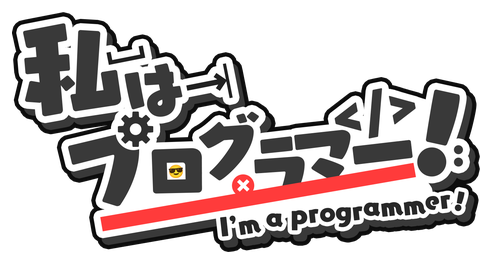
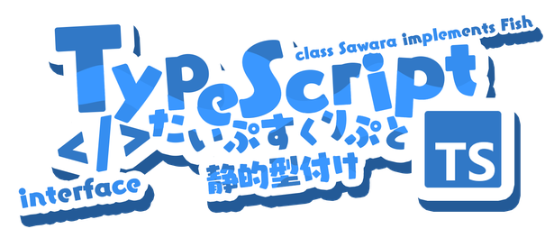
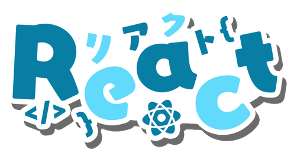
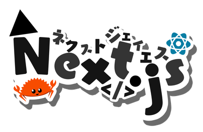
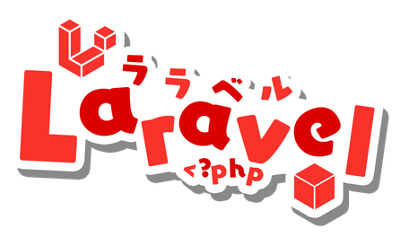
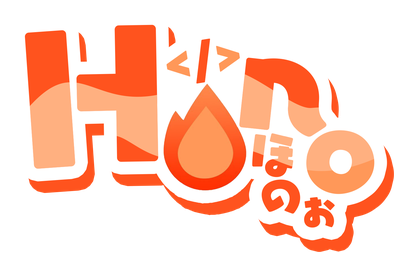
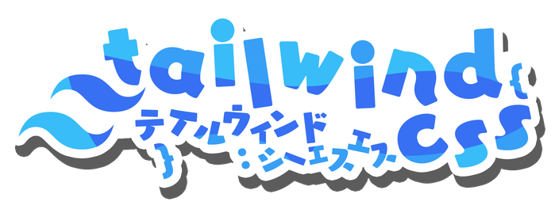
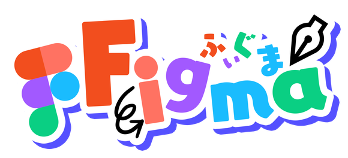

  

  

  
  
  
  
  
  
  
  
  
  

  Logos by <a href="https://github.com/SAWARATSUKI/KawaiiLogos">SAWARATSUKI / KawaiiLogos</a> ・ Font: <a href="https://fonts.google.com/specimen/Mochiy+Pop+One">Mochiy Pop One</a>

